# Credit Risk Analysis – Home Credit Default Risk

**Which loan applicants are most likely to default, and how can a lender use that to make better credit decisions?**

An end-to-end credit risk analysis of **307,511 loan applications** in Python: data cleaning, exploratory analysis of default drivers, Credit Bureau history, and a simple, interpretable scoring model that splits clients into risk segments for the Credit Risk team.

**Tools:** Python · pandas · NumPy · Matplotlib · Seaborn · scikit-learn  
**Data:** [Home Credit Default Risk (Kaggle)](https://www.kaggle.com/competitions/home-credit-default-risk)  
**Full analysis:** [`EAD BANK RISK.ipynb`](EAD%20BANK%20RISK.ipynb)

---

## Key Results

| | |
|---|---|
| **8.1%** | portfolio default rate (24,825 of 307,511 loans) |
| **11×** | difference in default rate between the lowest (22.9%) and highest (2.0%) external credit score deciles |
| **2×** | higher default rate for clients employed < 2 years (11.2%) vs 10+ years (5.2%) |
| **0.74** | ROC AUC of the scoring model (Gini 0.49) |
| **50%** | of all defaults are found by reviewing only the riskiest **20%** of applications |

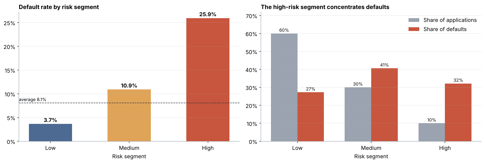

---

## 1. Business Questions

Acting as a **Data Analyst in a Credit Risk team**, reporting to the **Credit Risk Manager**:

1. What does the loan portfolio look like, and what is the overall level of risk?
2. Which client characteristics are most strongly linked to default?
3. Does credit history from other lenders (Credit Bureau) help predict risk?
4. How can clients be grouped into **low / medium / high** risk segments to support lending decisions?

## 2. Data

| Table | Rows | Description |
|---|---|---|
| `application_train.csv` | 307,511 | One row per loan application – client profile, loan details and `TARGET` (1 = default) |
| `bureau.csv` | 1,716,428 | Client's previous loans at other financial institutions |
| `HomeCredit_columns_description.csv` | – | Data dictionary |

> The raw data files are not stored in this repository (GitHub file size limit). Download them from Kaggle and place them next to the notebook to re-run the analysis.

## 3. Data Cleaning & Feature Engineering

- **Missing values:** 67 of 122 columns had gaps. I dropped 48 columns with > 40% missing values (mostly building characteristics), but **kept the external credit scores** `EXT_SOURCE_1` / `EXT_SOURCE_3` because they are key risk indicators.
- **Placeholder values:** `DAYS_EMPLOYED = 365243` (≈ 1,000 years) appeared in 18% of rows – only for pensioners and unemployed clients. I replaced it with `NaN` and kept the information as a `NOT_EMPLOYED` flag.
- **Outliers:** capped annual income at the 99.9th percentile (max was 117 million vs a median of 147k).
- **New features** used in real credit assessment: age, years employed, loan-to-income, **annuity-to-income (DTI)**, **loan-to-goods-price (LTV-style)**, and a combined external score.

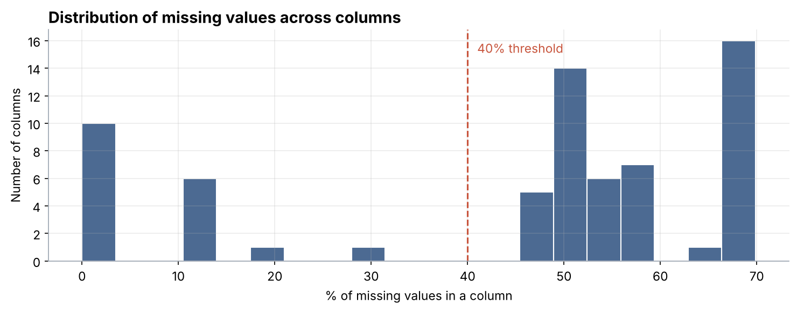

## 4. Portfolio Overview

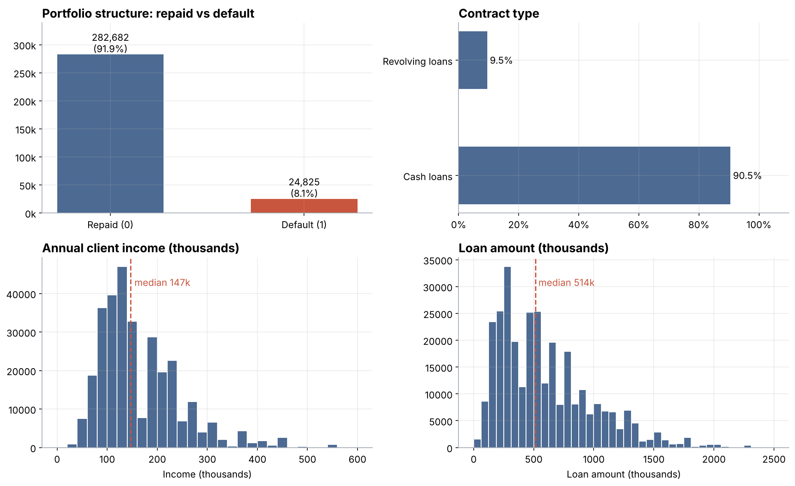

- **~90%** of loans are cash loans, the rest are revolving loans.
- A typical client earns **~147k** a year and borrows **~3.3× their annual income**.
- Income and loan amounts are right-skewed, so medians are used throughout.

## 5. What Drives Default?

Each chart compares the **default rate within a group** with the **portfolio average (8.1%)**. Red = above average, blue = below average.

### External credit score – the strongest signal
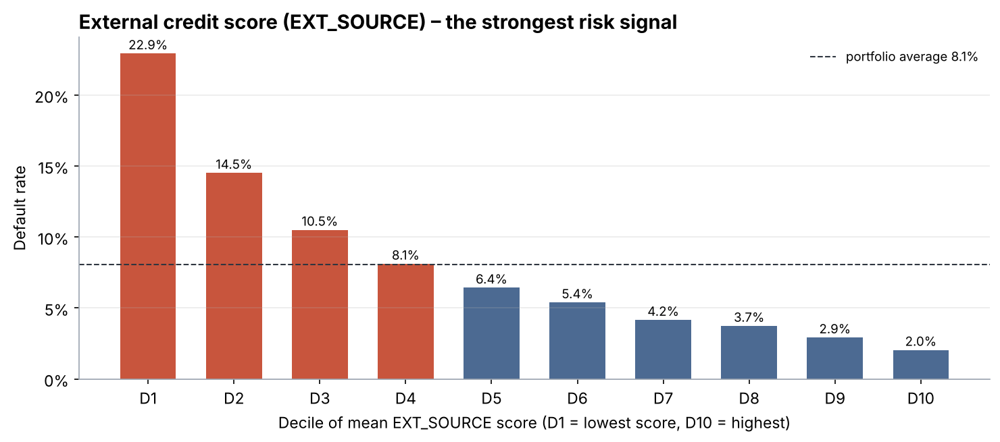

Default rate falls from **22.9%** in the lowest score decile to **2.0%** in the highest – an **11×** difference. Any approval rule should be built primarily on this score.

### Age and employment stability
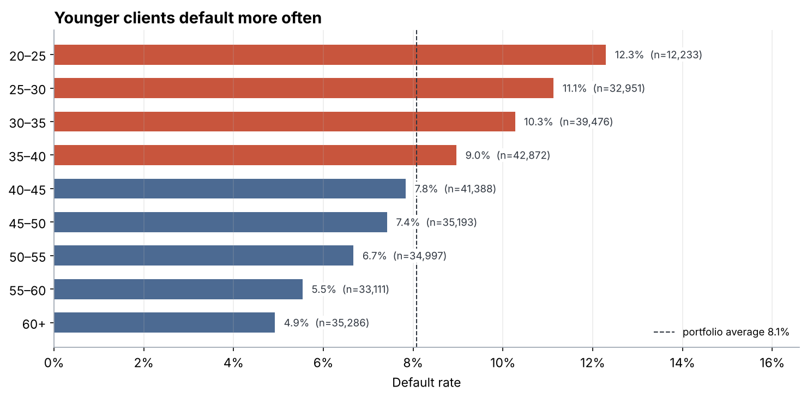
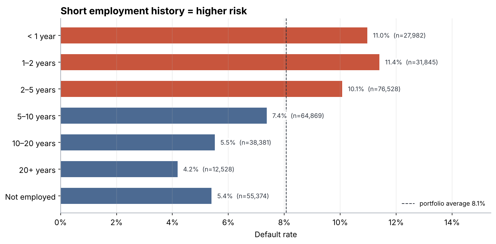

- Risk **falls steadily with age**: clients aged 20–25 default **2.5× more often** than clients aged 60+.
- Clients employed **< 2 years** default about **2× more often** than those employed 10+ years.

> Age is a sensitive attribute – in the EU it should not be the sole reason to reject a loan, so it is treated as a signal to monitor, not a decision rule.

### Income type, education and occupation
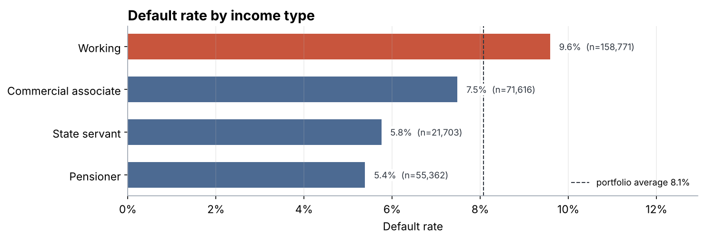
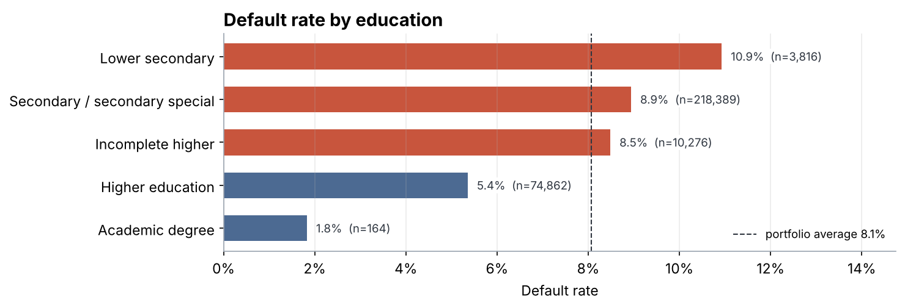
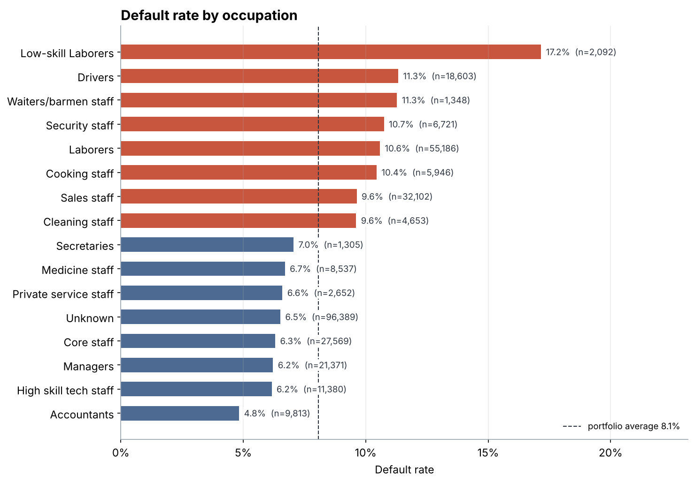

- **Pensioners** and **state servants** are the safest groups (~5.5%) thanks to stable income.
- **Higher education** is linked to almost **2× lower** risk than lower secondary education.
- **Low-skill laborers** have the highest risk (**17.2%**), followed by drivers, waiters and security staff. Accountants and managers have the lowest.

### Repayment burden, loan size and region
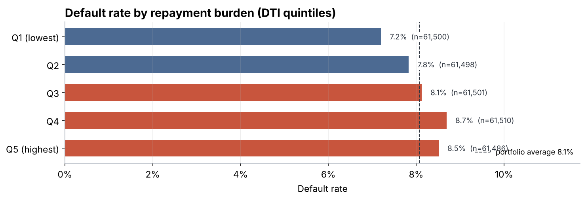
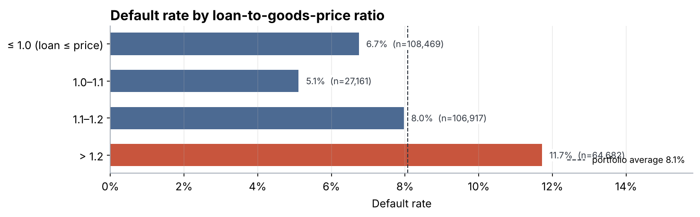
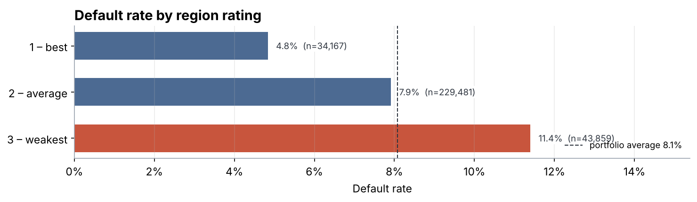

- The repayment burden (DTI) separates risk **only weakly** – high DTI is probably already filtered out at approval.
- Clients who **borrow more than 120% of the goods price** default **11.7%** of the time vs **6.7%** when the loan ≤ the price.
- Clients from the weakest-rated regions default **2.4×** more often than those from the best-rated regions.

### Correlation summary
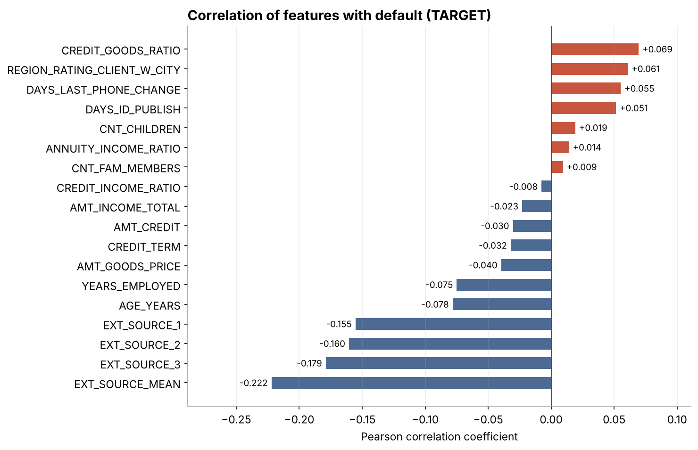

## 6. Credit Bureau History

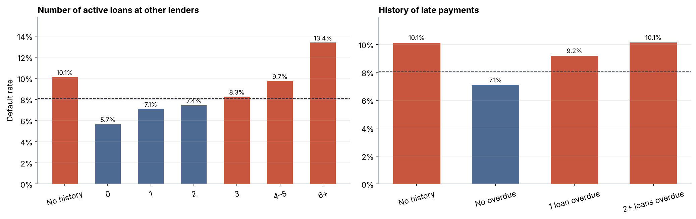

- More **active loans at other lenders** means higher risk – **13.4%** for clients with 6+ active loans.
- **Past late payments** raise risk (10.1% with 2+ late loans vs 7.1% with none).
- Clients with **no credit history** (*thin file*) are also above average (**10.1%**) – the lender simply knows less about them.

## 7. Risk Segmentation – Scoring Model

A **logistic regression** model (the industry standard for credit scorecards – easy to explain to regulators) combines 48 features into one risk score.  
**Gender and age are deliberately excluded** from the model as protected attributes.

| Segment | Share of applications | Default rate | Share of all defaults |
|---|---|---|---|
| Low risk | 60% | 3.7% | 27% |
| Medium risk | 30% | 10.9% | 41% |
| **High risk** | **10%** | **25.9%** | **32%** |

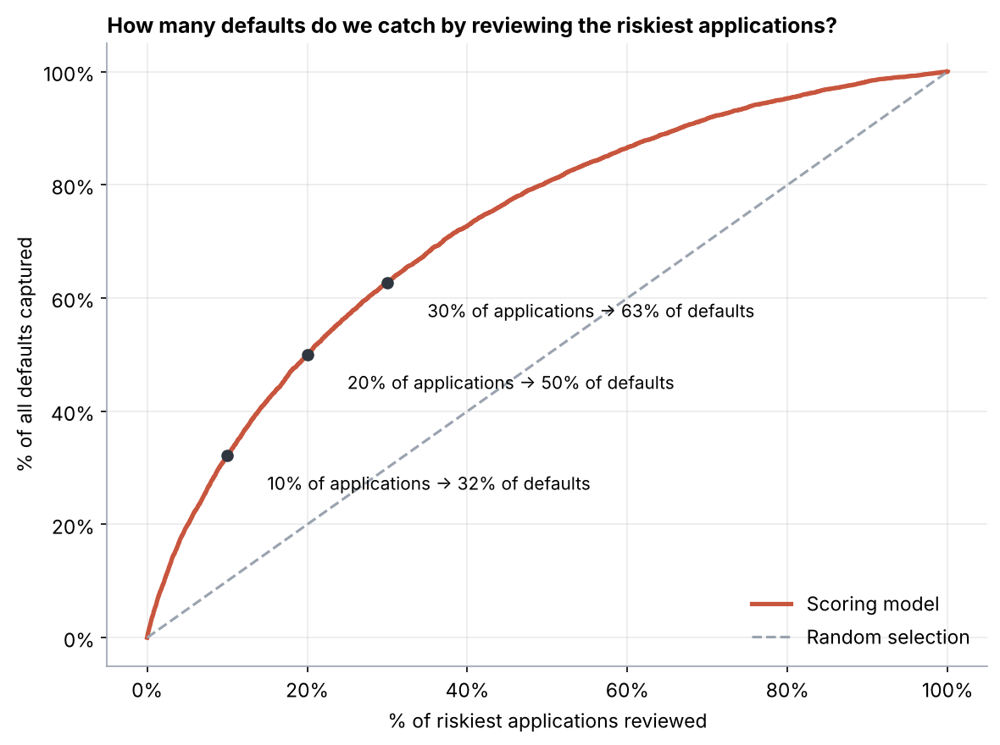

Reviewing the riskiest **10% / 20% / 30%** of applications captures **32% / 50% / 63%** of all defaults.

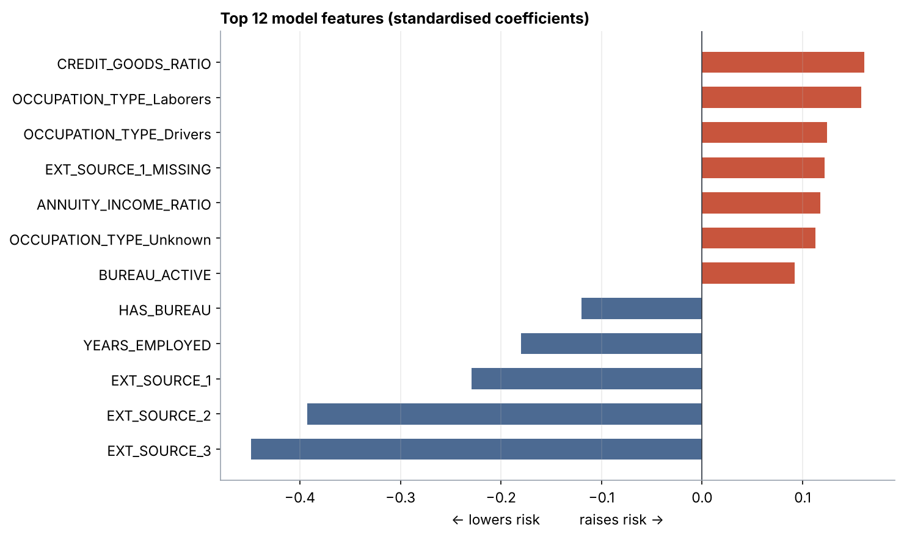

## 8. Recommendations

1. **3-tier decision path based on the score**
   - *Low risk* → fast, automated approval
   - *Medium risk* → standard verification
   - *High risk* → manual review, lower loan amount or collateral
2. **Limit extra amounts added to the loan** (loan > goods price) for medium- and high-risk clients.
3. **A dedicated policy for thin-file clients** – a smaller first loan and gradual limit increases after on-time repayments, instead of automatic rejection.
4. **Monitor the portfolio on a dashboard** – default rate by segment, occupation, region and employment length, with alerts when a segment crosses a threshold.

## 9. Limitations & Next Steps

- No loan issue dates → no vintage or time-trend analysis.
- Only approved applications are available → no *reject inference*.
- The model is intentionally simple; gradient boosting could raise AUC at the cost of transparency.
- **Next:** add `previous_application` and `installments_payments`, and build an interactive **Power BI** dashboard.

## How to Run

```bash
pip install pandas numpy matplotlib seaborn scikit-learn jupyter
# download application_train.csv, bureau.csv and HomeCredit_columns_description.csv from Kaggle
# into the project folder (file names used in the notebook: application_train_.csv, bureau.csv)
jupyter notebook "EAD BANK RISK.ipynb"
```

## Repository Structure

```
├── EAD BANK RISK.ipynb   # full analysis with code, charts and commentary
├── images/               # charts used in this README
└── README.md
```

---

**Author:** Bui Anh Kiet – Master's student in Big Data, Poland · open to Data Analyst / BI roles
